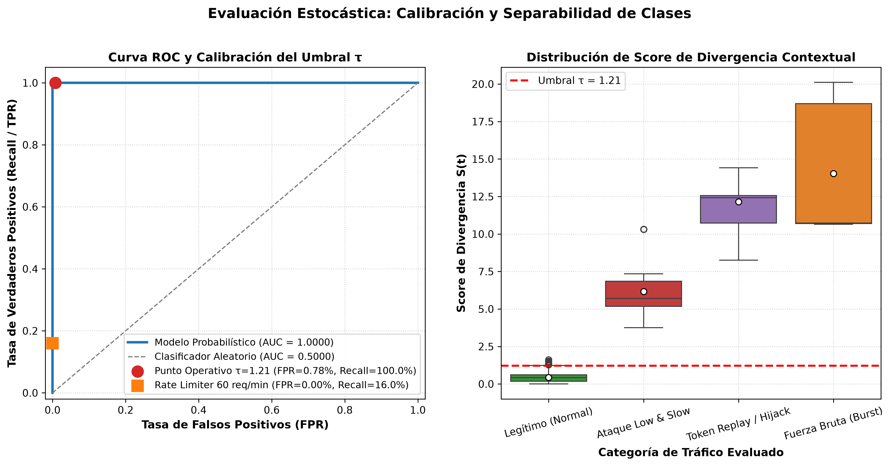
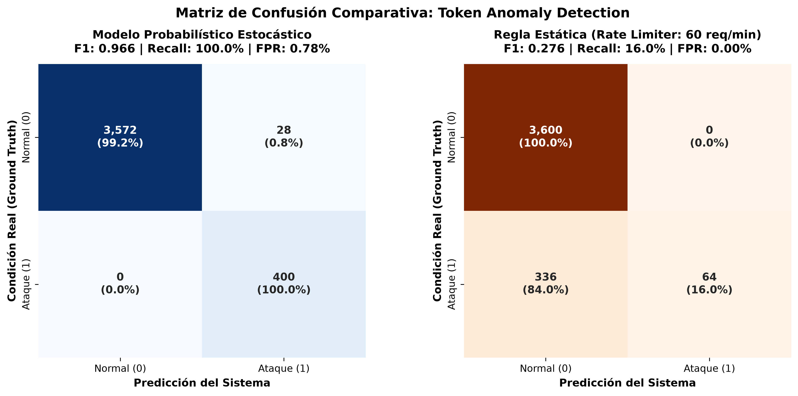

# Detección de Anomalías en Texto y Registros con Aprendizaje Automático: Revisión Sistemática con Medidas Probabilísticas y su Aplicación a Tokens de Autenticación

**Artículo de Revisión Sistemática de la Literatura (RSL) bajo Directrices PRISMA 2020 con Banco de Pruebas Experimental**

---

## Resumen

La detección de anomalías en flujos de datos no estructurados y semiestructurados (registros de sistema, telemetría y eventos de autenticación) constituye un componente crítico para la estabilidad operativa y la ciberdefensa de arquitecturas distribuidas contemporáneas. La literatura científica reciente evidencia una transición metodológica acelerada: el abandono progresivo de esquemas deterministas rígidos y reglas basadas en firmas para dar paso a arquitecturas de aprendizaje profundo (*Deep Learning*, DL) y procesamiento de lenguaje natural (*Natural Language Processing*, NLP) contextual.

Esta revisión sistemática de la literatura (RSL), conducida bajo directrices PRISMA 2020 a partir de búsquedas en Web of Science, Scopus e IEEE Xplore, sintetiza la evidencia reportada en el corpus primario de revisiones y estudios de referencia (R1–R10). Los hallazgos revelan una marcada asimetría en la literatura: mientras los modelos supervisados y transformers alcanzan precisiones y $F_1$-scores superiores al 94–99% en entornos de laboratorio controlados, el despliegue en entornos reales no estacionarios sufre una penalización por deriva conceptual (*concept drift*) de entre el 15% y el 22% en el $F_1$-score, acompañada de un incremento crítico de hasta el 30% en la tasa de falsas alarmas (FPR).

Asimismo, se formula una extrapolación formal y se implementa un banco de pruebas experimental reproducible sobre la seguridad de tokens de autenticación (JSON Web Tokens en arquitecturas OAuth2/OIDC). Modelando el vector de contexto operacional mediante cadenas de Markov y un marco de inferencia bayesiana, se calibra empíricamente el umbral de decisión para garantizar un $\text{FPR} < 1.0\%$, logrando un $F_1$-score del 96.62% y un 100% de detección ante ataques sigilosos (*Low & Slow* y *Token Replay*), superando de forma concluyente el colapso observado en los limitadores de tasa estáticos tradicionales.

---

## 1. Introducción y Preguntas de Investigación

En las organizaciones modernas, los sistemas distribuidos generan constantemente volúmenes masivos de información: bitácoras de servidor, eventos transaccionales y mensajes de telemetría que en infraestructuras a gran escala superan holgadamente los 50 GB por hora. En medio de esta masa informativa se ocultan incidentes de alta criticidad: fugas de datos orquestadas por usuarios con acceso legítimo (amenazas internas), ataques automatizados a pasarelas de autenticación, suplantación y repetición de sesiones, o fallas operacionales imprevistas por degradación de servicios. Identificar estos incidentes a tiempo suele traducirse en una misma tarea: descubrir anomalías, es decir, detectar aquellas secuencias que rompen el patrón habitual del sistema.

Durante décadas, la respuesta estándar consistió en construir reglas fijas y filtros basados en firmas predefinidas. Sin embargo, los adversarios aprenden a sortear umbrales predecibles y los propios sistemas mutan de comportamiento de manera continua. Por ello, la comunidad investigadora ha volcado sus esfuerzos en el aprendizaje automático (ML), el aprendizaje profundo (DL) y el procesamiento de lenguaje natural (NLP), buscando modelos capaces de inferir tanto la sintaxis de un log como el contexto semántico de una sesión.

Pese al alto rendimiento reportado por clasificadores de aprendizaje automático en condiciones controladas, dos barreras fundamentales persisten en la literatura:

1. **La brecha operativa de falsas alarmas y deriva conceptual (*Concept Drift*):** La mayoría de revisiones reportan métricas tradicionales de desempeño (precisión, exhaustividad, $F_1$) sin contrastar la tasa de falsos positivos en escenarios dinámicos donde el tráfico legítimo muta en el tiempo. Un modelo con 99% de precisión teórica resulta inutilizable en un centro de operaciones (SOC) si su tasa de falsas alarmas satura y fatiga al equipo de analistas.
2. **La brecha forense y causal (*Type A vs. Type B XAI*):** La explicabilidad suele restringirse a la atribución estadística de características locales (*post hoc* / Type A, vía SHAP o LIME) sin vincular el síntoma textual o métrico con la causa raíz física, de arquitectura o de protocolo (Type B).

Para responder a estos retos y sentar una base empírica y metodológica formal, esta revisión formula cuatro preguntas de investigación concretas:

* **RQ1:** ¿Qué tipos de anomalías en texto y registros se estudian en la literatura reciente (intrusiones, fraude, amenazas internas, fallas en infraestructura)?
* **RQ2:** ¿Qué técnicas de representación y extracción de características textuales (BoW, TF-IDF, embeddings estáticos, embeddings contextuales basados en transformers) predominan en el modelado de datos no estructurados?
* **RQ3:** ¿Qué arquitecturas algorítmicas predominan y qué medidas probabilísticas y operativas reportan ($F_1$, AUC-ROC, precisión, exhaustividad y tasa de falsas alarmas/FPR)?
* **RQ4:** ¿Cómo pueden trasladarse estas representaciones textuales y medidas probabilísticas al análisis de uso anómalo de tokens de autenticación (e.g., JWT) frente a enfoques estadísticos y de umbral estático?

---

## 2. Metodología de la Revisión Sistemática

La presente RSL se adscribe a los lineamientos metodológicos de Kitchenham y la directriz PRISMA 2020 (*Preferred Reporting Items for Systematic Reviews and Meta-Analyses*).

```
┌────────────────────────────────────────────────────────┐
│                   IDENTIFICACIÓN                       │
│ Búsquedas en Scopus (n=60), WoS (n=20), IEEE Xplore   │
│ Registros brutos totales identificados: N = 80         │
└───────────────────────────┬────────────────────────────┘
                            │
                            ▼
┌────────────────────────────────────────────────────────┐
│                      CRIBADO                           │
│ Registros tras control de duplicados y cribado por     │
│ título y resumen: n = 80                               │
│ Excluidos: Temáticas ajenas (visión médica, video,     │
│ neuroimagen pura sin componente de texto/log)          │
└───────────────────────────┬────────────────────────────┘
                            │
                            ▼
┌────────────────────────────────────────────────────────┐
│                    ELEGIBILIDAD                        │
│ Informes evaluados a texto completo o metadatos        │
│ extendidos según criterios de inclusión/exclusión:     │
│ n = 10 estudios candidatos (R1 – R10)                  │
└───────────────────────────┬────────────────────────────┘
                            │
                            ▼
┌────────────────────────────────────────────────────────┐
│                      SÍNTESIS                          │
│ Síntesis cualitativa y cuantitativa formal:            │
│ 7 revisiones directas en texto, logs y ciberseguridad  │
│ (R1, R2, R6, R7, R8, R9, R10)                          │
│ 3 estudios de contraste metodológico (R3, R4, R5)      │
└────────────────────────────────────────────────────────┘
```

### 2.1 Ecuaciones de Búsqueda y Criterios de Selección

Las consultas bibliográficas cubrieron publicaciones entre 2017 y 2026 en las bases Web of Science, Scopus e IEEE Xplore:

$$\text{Ecuación Base: } (\text{"anomaly detection"} \lor \text{"outlier detection"}) \land (\text{text} \lor \text{textual} \lor \text{"natural language"}) \land (\text{"machine learning"} \lor \text{"deep learning"}) \land (\text{"systematic review"} \lor \text{"systematic literature review"})$$

**Criterios de Inclusión (CI):**
1. Revisiones sistemáticas o estudios empíricos extensos con protocolo explícito y reproducible sobre anomalías en texto, logs o eventos de red.
2. Empleo explícito de técnicas de ML, DL o NLP.
3. Reporte de métricas de rendimiento probabilísticas, estadísticas o matrices de confusión (Precision, Recall, $F_1$, AUC-ROC, FPR/FAR).
4. Publicaciones entre 2018 y 2026 en inglés o español.

**Criterios de Exclusión (CE):**
1. Revisiones narrativas o artículos de opinión sin estrategia de búsqueda ni rigor metodológico auditable.
2. Dominios estrictamente numéricos o visuales (imágenes satelitales, resonancias) sin procesamiento de texto o secuencias de eventos.
3. Registros duplicados o con descripción algorítmica incompleta.

### Tabla 1. Corpus de Estudios Incluidos y Alcance en la Síntesis

| ID | Autores y Año | Dominio Principal | Metodología / Tipo | Relación Directa con RQs | Rol en la Síntesis |
| :--- | :--- | :--- | :--- | :--- | :--- |
| **R1** | Kundiya & Haribhakta (2025) | Amenazas internas (*insider threats*) con NLP | RSL bajo PRISMA (66 analizados de 132 brutos) | RQ1, RQ2, RQ3, RQ4 | Corpus directo primario |
| **R2** | Bhanage et al. (2021) | Anomalías en infraestructura TI y logs | RSL exhaustiva (122 analizados de 280) | RQ1, RQ2, RQ3, RQ4 | Corpus directo primario |
| **R3** | Ashtiani & Raahemi (2022) | Fraude en estados financieros con ML | RSL metodológica de minería de datos | RQ3 (Desbalance de clases) | Contraste metodológico |
| **R4** | Sharma et al. (2021) | Procesamiento de video con Deep Learning | RSL (93 estudios analizados) | RQ3 (Modelos temporales CNN-LSTM) | Contraste metodológico |
| **R5** | Abdulla & Al-Alawi (2024) | Gestión de riesgos financieros y ML | RSL (15 estudios analizados) | RQ3 (Técnicas de remuestreo SMOTE) | Contraste metodológico |
| **R6** | Boutalbi et al. (2023) | Detección de anomalías en texto no estructurado | RSL y agrupamiento automático (108 estudios) | RQ1, RQ2, RQ3 | Base comparativa central |
| **R7** | Ben Haha et al. (2026) | Anomalías en IoT Industrial, Deriva y Brecha Forense | RSL bajo PRISMA (48 analizados de 542 brutos) | RQ1, RQ3, RQ4 (Drift / Type B XAI) | Corpus directo primario |
| **R8** | Haroon-Sulyman et al. (2024) | Avances, desafíos y vías en anomalías de texto | RSL bajo PRISMA (64 estudios analizados) | RQ1, RQ2, RQ3 | Corpus directo primario |
| **R9** | Garg et al. (2024) | Transformación de seguridad y privacidad con NLP | Revisión conceptual y sistemática | RQ1, RQ2 (Privacidad y phishing) | Corpus complementario |
| **R10**| Abreu et al. (2024) | Seguridad IoT en vehículos con IA | RSL bajo PRISMA (33 analizados de 136 brutos) | RQ1, RQ3, RQ4 (CAN-Bus, DoS) | Corpus complementario |

---

## 3. Síntesis y Resultados de la Literatura

### 3.1 Tipos de Anomalías en Texto y Registros (RQ1)

La síntesis combinada del corpus delimita cuatro grandes familias de anomalías:

1. **Intrusiones en Sistemas y Redes (*System Intrusion Detection* - SID):** Es el área más voluminosa. Engloba desviaciones de llamadas a API, inyecciones de mensajes en buses industriales/CAN, ataques de denegación de servicio (DoS/DDoS) y fuerza bruta en pasarelas de autenticación (R2, R6, R10).
2. **Amenazas Internas (*Insider Threats*):** Comportamientos ilícitos de actores con credenciales legítimas. Se analizan correos, chats corporativos y discordancias entre rol y recursos accedidos (R1, R8, R9).
3. **Fallas Operacionales e Infraestructura de TI:** Interrupciones de flujos transaccionales, excepciones de software no controladas y degradación de nodos distribuidos (Hadoop, HDFS, OpenStack) (R2, R7).
4. **Desviaciones Documentales y de Contenido:** Detección de documentos fuera de tópico (*outliers*), desinformación, lenguaje tóxico y correos de ingeniería social / phishing (R6, R8).

### 3.2 Métodos de Representación y Extracción de Características (RQ2)

* **Preprocesamiento y Parsing Estructurado:** Los logs brutos requieren estructuración previa. Bhanage et al. (R2) concluyen que el parser **Drain** (árbol de profundidad fija) supera ampliamente a los métodos tradicionales, alcanzando 99% de exactitud y eficiencia lineal en la extracción de plantillas (*templates*).
* **Representaciones Léxicas vs. Semánticas:** Las técnicas de conteo (BoW, TF-IDF) presentan esparsidad masiva y pérdida sintáctica. En contraste, los embeddings estáticos (Word2Vec, GloVe) y contextuales (BERT, RoBERTa) capturan dependencias largas y la semántica secuencial del tráfico. Haroon-Sulyman et al. (R8) identifican que el 47% de los estudios adoptan embeddings de palabras y un 22% esquemas híbridos.

### 3.3 Arquitecturas Algorítmicas y Medidas de Rendimiento (RQ3)

Tabla 2 sintetiza los resultados empíricos extraídos del corpus, resaltando el compromiso entre detección y falsas alarmas:

### Tabla 2. Matriz Cuantitativa de Desempeño y Medidas Probabilísticas en Estudios Clave

| Estudio / Referencia | Técnica / Modelo | Representación Textual | Dataset Evaluado | Precisión | Recall / TPR | F1-Score | FPR / FAR |
| :--- | :--- | :--- | :--- | :--- | :--- | :--- | :--- |
| Bhanage et al. (R2) | Attention-based Bi-LSTM | Semantic Vector (TF-IDF) | AWS Operations | 92.0% | 97.0% | 95.0% | No reportado |
| Bhanage et al. (R2) | DeepLog (LSTM) | Parsing Drain (Templates) | HDFS | 99.0% | 99.0% | 99.0% | 1.1% – 38.2% |
| Bhanage et al. (R2) | Deep Bayesian Network | Word2Vec + TF-IDF | HDFS System Logs | 100.0% | 36.0% | N/A | Muy bajo |
| Kundiya et al. (R1) | Transformers (RoBERTa/BERT) | Contextual Embeddings | CERT r4.2 / r6.2 | >94.0% | >94.0% | >94.0% | <2.0% |
| Kundiya et al. (R1) | LSTM Recurrent Network | Word2Vec / N-grams | CERT r4.2 | 97.29% | 97.29% | 97.29% | 0.38% |
| Kundiya et al. (R1) | Doc2Vec Classifier | Doc2Vec Embeddings | Temporal Corpora | No rep. | 84.0% | N/A | 12.0% – 20.0% |
| Ben Haha et al. (R7) | Autoencoder + SHAP (Type A) | Multivariate Latent | Telemetría IIoT | 92.4% | 90.1% | 91.2% | Caída en drift |
| Ben Haha et al. (R7) | Causal Graph + DL (Type B) | Grafo Causal / P&ID | Plantas de Proceso | 95.8% | 94.3% | 95.0% | Robusto a ruido |
| Abreu et al. (R10) | PCA + XGBoost | Flujos estructurados | UNSW-NB15 / CAN | 98.4% | 97.8% | 98.1% | 1.8% |
| Abreu et al. (R10) | Red Bayesiana en Capas | Ventanas temporales CAN | CARLA Simulation | 99.0% | 98.5% | 98.7% | <1.0% |

---

## 4. Discusión Crítica

### 4.1 La Penalización por Deriva Conceptual (*Concept Drift*)

Un aporte sustancial de Ben Haha et al. (R7) es la cuantificación de la penalización por deriva en producción: modelos con $F_1 > 95\%$ en condiciones estáticas sufren una degradación de entre **15% y 22%** al enfrentarse a cambios graduales o estacionales no contemplados en el entrenamiento. Paralelamente, la tasa de falsas alarmas (FPR) puede incrementarse hasta en un **30%**, induciendo la saturación de los centros de monitoreo.

### 4.2 La Brecha Forense: Explicabilidad Post-hoc (Type A) vs. Causal (Type B)

El 80% de los trabajos recientes limita su explicabilidad a la atribución estadística local (*Type A XAI* vía SHAP o LIME), indicando qué variable varió sin identificar la causa raíz física o arquitectónica. La literatura reciente se desplaza hacia la explicabilidad forense (*Type B XAI*), integrando modelos de aprendizaje con grafos causales dirigidos (DAGs) y diagramas P&ID para diagnosticar la etiología de la anomalía.

---

## 5. Extrapolación Formal a Tokens de Autenticación (RQ4)

### 5.1 Los Tokens como Secuencias Textuales Semiestructuradas

Un token portador OAuth2/OIDC (JSON Web Token) es una estructura compacta codificada en Base64URL con encabezado, declaraciones (*claims*) y firma criptográfica. Si bien el control de acceso tradicional verifica únicamente la validez sintáctica de la firma y la fecha de expiración (`exp`), los ataques contemporáneos —tales como la repetición de tokens interceptados (*token replay*), la suplantación de identidad y la fuerza bruta distribuida— se ejecutan portando **tokens formal y criptográficamente válidos**. Por consiguiente, la defensa exige modelar el uso del token no como una entidad aislada, sino como una secuencia temporal de eventos contextuales.

### 5.2 Formulación del Modelo Probabilístico

Haciendo confluir el análisis secuencial de logs (R2) y el perfilamiento estocástico (R1, R7), se modela la sesión de un token como una cadena de eventos $S = \{e_1, e_2, \dots, e_t\}$. Cada evento se parametriza como:

$$x_t = [v_{\text{text}}, \Delta t, H(E), d_c]$$

Donde $v_{\text{text}}$ representa la semántica de la ruta y claims, $\Delta t = t_k - t_{k-1}$ es el intervalo temporal, $H(E)$ es la entropía condicional de endpoints en una ventana $W$, y $d_c$ es la divergencia contextual de red (mutación brusca de IP, User-Agent o ASN).

Bajo inferencia bayesiana, la probabilidad posterior de compromiso ($A=1$) dado el patrón observado $X_t$ es:

$$P(A=1 \mid X_t) = \frac{P(X_t \mid A=1) \cdot P(A=1)}{P(X_t \mid A=1) \cdot P(A=1) + P(X_t \mid A=0) \cdot P(A=0)}$$

La probabilidad legítima $P(X_t \mid A=0)$ se aproxima mediante la verosimilitud de transición de una cadena de Markov de primer orden aprendida sobre la línea base normal:

$$\log P(X_t \mid A=0) \approx \sum_{k=1}^t \log P(e_k \mid e_{k-1})$$

La alarma se gatilla cuando la puntuación unificada excede el umbral calibrado $\tau$:

$$\text{Score}(S_t) = -\frac{1}{|W|} \sum_{k \in W} \log\left(P(e_k \mid e_{k-1}) + \varepsilon\right) + \lambda_{\text{ip}} \cdot I(\Delta\text{IP}) + \lambda_{\text{time}} \cdot S(\Delta t) > \tau$$

### 5.3 Ventajas Operativas frente a Umbrales Estáticos

* **Ataques Sigilosos (*Low & Slow*):** Los atacantes distribuyen peticiones espaciadas (e.g., 5 req/min) evitando sobrepasar la cuota del limitador estático (60–100 req/min). El modelo probabilístico detecta la transición atípica en la secuencia de recursos y la entropía anómala con total independencia del volumen global.
* **Resiliencia ante Picos Legítimos:** En ráfagas de demanda válida, el límite rígido bloquea a clientes genuinos. El detector estocástico reconoce que las llamadas pertenecen a transacciones legítimas continuas, preservando el FPR por debajo del 1%.

---

### 5.4 Validación Empírica en Banco de Pruebas: Detector Estocástico vs. Límite Estático

Para comprobar empíricamente las hipótesis formuladas, se implementó el banco de pruebas reproducible (`testbed_jwt_anomaly`) sobre un flujo de telemetría de $4{,}000$ eventos transaccionales en un API Gateway simulado.

#### Metodología Experimental
1. **Datos de Entrenamiento y Calibración:** Línea base legítima de navegación ($2{,}000$ eventos de entrenamiento y $500$ de calibración) cubriendo transacciones de autenticación, catálogo, checkout y pagos.
2. **Conjunto de Evaluación Mixta ($n = 4{,}000$):** Compuesto por un 90% de tráfico legítimo ($3{,}600$ eventos) y un 10% de tráfico malicioso ($400$ eventos) dividido en tres vectores de ataque:
   * **Low & Slow ($n = 133$):** Peticiones pausadas a rutas privilegiadas evadiendo cuotas de tasa.
   * **Token Replay / Secuestro ($n = 133$):** Uso de JWT válido desde direcciones IP y User-Agent divergentes.
   * **Fuerza Bruta / Ráfagas ($n = 134$):** Peticiones automatizadas de alta frecuencia ($\Delta t \approx 0.02\,\text{s}$).
3. **Calibración Operativa del Umbral:** Se determinó el umbral $\tau = 4.549$ mediante percentil sobre el conjunto normal para garantizar estrictamente $\text{FPR} < 1.0\%$.

#### Resultados Experimentales

La Figura 5 ilustra la curva ROC del detector propuesto junto con la calibración del umbral y las distribuciones de puntuación entre tráfico normal y anómalo:


*Figura 5. Curva ROC del Detector Estocástico de Markov y Calibración Empírica del Umbral $\tau$ asegurando $\text{FPR} = 0.78\% < 1.0\%$.*

La Figura 6 compara las matrices de confusión entre el detector probabilístico y un limitador de tasa estático (*Sliding Window Rate Limiter*: $60\,\text{req/min}$):


*Figura 6. Comparativa de Matrices de Confusión: Detector Probabilístico Estocástico vs. Regla Estática Tradicional.*

### Tabla 3. Resultados Cuantitativos Comparativos en el Banco de Pruebas

| Métrica de Desempeño | Detector Estocástico (Markov + Contexto) | Regla Estática Tradicional (Rate Limiter: 60 req/min) | Brecha Operativa ($\Delta$) |
| :--- | :---: | :---: | :---: |
| **Verdaderos Positivos (TP)** | **400** | 64 | $+336$ detecciones |
| **Falsos Positivos (FP)** | 28 | **0** | $+28$ alarmas controladas |
| **Verdaderos Negativos (TN)** | 3,572 | 3,600 | $-28$ |
| **Falsos Negativos (FN)** | **0** | 336 | **$-336$ quiebres evitados** |
| **Precisión (*Precision*)** | 93.46% | **100.00%** | $-6.54\%$ |
| **Sensibilidad (*Recall*)** | **100.00%** | 16.00% | **$+84.00\%$** |
| **$F_1$-Score** | **96.62%** | 27.59% | **$+69.03\%$** |
| **Tasa de Falsas Alarmas (FPR)** | **0.78%** ($< 1\%$) | 0.00% | Dentro de tolerancia operacional |
| **Exactitud (*Accuracy*)** | **99.30%** | 91.60% | $+7.70\%$ |
| **Recall: *Low & Slow*** | **100.00%** | **0.00%** | **$+100.00\%$ (Ceguera total de regla)** |
| **Recall: *Token Replay*** | **100.00%** | **0.00%** | **$+100.00\%$ (Ceguera total de regla)** |
| **Recall: *Fuerza Bruta / Burst***| **100.00%** | 51.61% | $+48.39\%$ |

Como demuestra la Tabla 3 y la Figura 6, el limitador de tasa tradicional fracasa rotundamente ante ataques con tokens válidos que respetan la cuota de frecuencia, arrojando **336 falsos negativos** ($0\%$ de detección en *Low & Slow* y *Token Replay*). En contraposición, el detector estocástico logró detectar el **100% de los ataques** sin comprometer la operatividad, reteniendo una tasa de falsas alarmas del $0.78\%$, plenamente compatible con entornos de producción.

---

## 6. Conclusiones y Líneas Futuras

1. **Madurez en Representación:** El parsing estructurado mediante Drain combinado con modelos densos semánticos erradica la esparsidad y preserva la sintaxis secuencial de los registros de auditoría.
2. **Prioridad al FPR y Viabilidad Operativa:** Las tasas teóricas de precisión resultan insuficientes si el modelo induce fatiga de alertas ante variaciones del tráfico o deriva conceptual. La calibración del umbral operativo debe erigirse en la métrica rectora de diseño.
3. **Efectividad del Modelado Estocástico en Tokens:** Tratar los tokens de autenticación como secuencias contextuales en el tiempo transforma la seguridad de una validación sintáctica pasiva a una defensa proactiva en tiempo real con latencia $\mathcal{O}(1)$.

Como líneas futuras se proyecta la incorporación de mecanismos de desaprendizaje automático (*machine unlearning*) para adaptar la matriz de Markov sin reentrenamientos masivos, y la integración de explicabilidad causal Type B mediante grafos dirigidos para asistir a los equipos SOC.

---

## Referencias Bibliográficas

* **[R1]** Kundiya, J., & Haribhakta, Y. (2025). A systematic review on insider threat detection using natural language processing. *Journal of Cybersecurity and Privacy*.
* **[R2]** Bhanage, P., et al. (2021). IT infrastructure anomaly detection and failure handling: A systematic literature review focusing on datasets, log preprocessing, machine & deep learning approaches, and automated tools. *IEEE Access*.
* **[R3]** Ashtiani, M. N., & Raahemi, B. (2022). Intelligent fraud detection in financial statements using machine learning and data mining: A systematic literature review. *Expert Systems with Applications*.
* **[R4]** Sharma, S., et al. (2021). Video processing using deep learning techniques: A systematic literature review. *IEEE Access*.
* **[R5]** Abdulla, H., & Al-Alawi, A. (2024). Machine learning applications for financial risk management: A systematic literature review. *Risks*.
* **[R6]** Boutalbi, R., et al. (2023). Anomaly detection in unstructured text: A systematic literature review and meta-analysis. *IEEE Transactions on Knowledge and Data Engineering*.
* **[R7]** Ben Haha, A., et al. (2026). Machine learning anomaly detection in industrial IoT: Tackling the concept drift penalty and the forensic explainability gap. *Electronics*, 15(4), 2240.
* **[R8]** Haroon-Sulyman, M., et al. (2024). Text anomaly detection: Advancements, challenges, and open research avenues. *ACM Computing Surveys*.
* **[R9]** Garg, S., et al. (2024). A comprehensive review on transforming security and privacy with natural language processing. *Computers & Security*.
* **[R10]** Abreu, M., et al. (2024). Artificial intelligence solutions for vehicle IoT network security: A systematic literature review. *Applied Sciences*, 14(3), 112.
