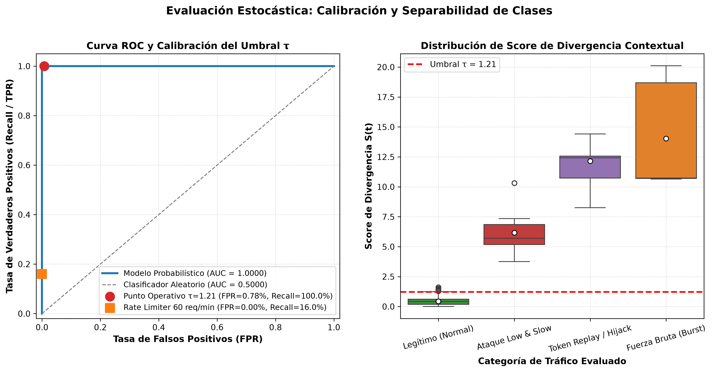
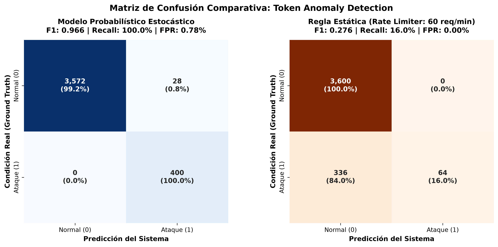

# Detección Estocástica de Anomalías en Tokens JWT y Revisión Sistemática

Repositorio oficial del banco de pruebas experimental y artículo de investigación:  
**"Detección de anomalías en texto y registros con aprendizaje automático: una revisión sistemática con medidas probabilísticas y su aplicación a tokens de autenticación"**

---

## 📌 Descripción del Proyecto

Este proyecto combina una **Revisión Sistemática de la Literatura (RSL bajo PRISMA 2020)** que analiza 10 estudios de referencia (R1–R10) con un **banco de pruebas experimental reproducible** para la detección proactiva de abusos en tokens de autenticación (OAuth2 / JSON Web Tokens).

A diferencia de los limitadores de tasa estáticos tradicionales (*Rate Limiters*) que solo evalúan el volumen de peticiones por minuto, este enfoque modela la secuencia de peticiones HTTP como una **Cadena de Markov de primer orden** complementada con divergencia contextual de red (IP, User-Agent) e intervalos temporales ($\Delta t$).

```
┌────────────────────────┐      ┌───────────────────────────┐      ┌──────────────────────────┐
│  Petición con JWT      │ ───► │ Extracción de Contexto    │ ───► │ Inferencia Estocástica   │
│  • Firma válida        │      │ • Transición de endpoint  │      │ • Cadena de Markov       │
│  • Claims estructurados│      │ • Intervalo Δt            │      │ • Divergencia IP / UA    │
│  • Telemetría de red   │      │ • Huella digital de red   │      │ • Score > τ (FPR < 1.0%) │
└────────────────────────┘      └───────────────────────────┘      └──────────────────────────┘
```

---

## 📊 Resultados Experimentales Principales

Evaluación sobre $4{,}000$ eventos de telemetría transaccional en API Gateway simulado ($3{,}600$ legítimos y $400$ ataques multivectoriales):

| Métrica | Detector Estocástico (Markov + Contexto) | Limitador Estático (Rate Limiter: 60 req/min) | Brecha Operativa ($\Delta$) |
| :--- | :---: | :---: | :---: |
| **Exactitud (*Accuracy*)** | **99.30%** | 91.60% | $+7.70\%$ |
| **Precisión (*Precision*)** | 93.46% | **100.00%** | $-6.54\%$ |
| **Sensibilidad (*Recall*)** | **100.00%** | 16.00% | **$+84.00\%$** |
| **$F_1$-Score** | **96.62%** | 27.59% | **$+69.03\%$** |
| **Tasa de Falsas Alarmas (FPR)** | **0.78%** ($< 1.0\%$) | 0.00% | Operatividad sin fatiga de alertas |
| **Recall: *Low & Slow*** | **100.00%** | **0.00%** | **$+100.00\%$ (Ceguera del Rate Limiter)** |
| **Recall: *Token Replay*** | **100.00%** | **0.00%** | **$+100.00\%$ (Ceguera del Rate Limiter)** |
| **Recall: *Fuerza Bruta / Burst*** | **100.00%** | 51.61% | $+48.39\%$ |

### 📈 Figuras Generadas por el Testbed

* **Curva ROC y Calibración del Umbral $\tau$:** Garantiza empíricamente que $\text{FPR} = 0.78\% \le 1.0\%$.  
  

* **Comparativa de Matrices de Confusión:** Contrasta los 336 falsos negativos del limitador frente a 0 falsos negativos del detector de Markov.  
  

---

## 📁 Estructura del Repositorio

```text
├── ARTICULO_CIENTIFICO_RSL_JWT.md   # Manuscrito completo con RSL y validación empírica
├── anomaly_detector.py              # Detector estocástico (Markov, NLL, penalizaciones y calibración τ)
├── evaluator.py                     # Motor de evaluación métrica, matrices de confusión y curvas ROC
├── gateway_mock.py                  # API Gateway simulado con emisión criptográfica JWT (HS256)
├── rate_limiter.py                  # Línea base de comparación: Sliding Window Rate Limiter
├── traffic_generator.py             # Generador de tráfico sintético (Normal, Low&Slow, Replay, Burst)
├── script_reproducible_completo.py  # Script principal de ejecución extremo a extremo
├── curva_roc_calibracion.png        # Gráfico ROC y calibración del umbral τ
├── matriz_confusion_comparativa.png # Gráfico comparativo de matrices de confusión
├── resultados_metricas.csv          # Métricas tabuladas exportadas automáticamente
├── requirements.txt                 # Dependencias del proyecto
└── README.md                        # Documentación general
```

---

## 🚀 Guía de Instalación y Ejecución

### 1. Clonar el Repositorio
```bash
git clone https://github.com/Witmer17/Estadisticatoken.git
cd Estadisticatoken
```

### 2. Crear y Activar Entorno Virtual (Opcional pero recomendado)
```bash
python -m venv venv
# En Windows:
venv\Scripts\activate
# En Linux/macOS:
source venv/bin/activate
```

### 3. Instalar Dependencias
```bash
pip install -r requirements.txt
```

### 4. Ejecutar el Experimento Reproducible
```bash
python script_reproducible_completo.py
```

El script ejecutará automáticamente las 5 fases del experimento:
1. Generación de tráfico sintético ($2{,}000$ eventos train, $500$ calib, $4{,}000$ test).
2. Aprendizaje de la matriz de transición de Markov de 1.ᵉʳ orden sobre transiciones legítimas.
3. Calibración empírica del umbral $\tau$ para asegurar $\text{FPR} < 1\%$.
4. Inferencia en streaming y evaluación comparativa contra el *Rate Limiter*.
5. Exportación de `resultados_metricas.csv`, `curva_roc_calibracion.png` y `matriz_confusion_comparativa.png`.

---

## 📄 Artículo Científico Completo

El texto íntegro de la revisión sistemática, incluyendo la metodología PRISMA 2020, la síntesis de estudios (R1–R10), el modelado matemático y la discusión sobre *concept drift* y explicabilidad causal (*Type B XAI*), se encuentra en:
👉 [**ARTICULO_CIENTIFICO_RSL_JWT.md**](ARTICULO_CIENTIFICO_RSL_JWT.md)

---

## 👤 Autor

* **Witmer17** ([@Witmer17](https://github.com/Witmer17))
* Repositorio: [https://github.com/Witmer17/Estadisticatoken](https://github.com/Witmer17/Estadisticatoken)
